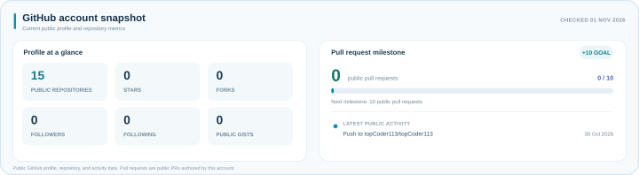

<picture>
  <source media="(prefers-color-scheme: dark)" srcset="assets/profile-header-dark.png" />
  
</picture>

### Building AI-powered apps, SaaS products & automations

<h2>&nbsp;What I do</h2>

I build practical end-to-end products—from modern web interfaces and Python APIs to LLM integrations and automated workflows.

 

<h2>&nbsp;Tech stack</h2>

<a href="https://www.figma.com/"><picture><source media="(prefers-color-scheme: light)" srcset="https://skillicons.dev/icons?i=figma&amp;theme=light" /></picture></a>&nbsp;
<a href="https://www.python.org/"><picture><source media="(prefers-color-scheme: light)" srcset="https://skillicons.dev/icons?i=python&amp;theme=light" /></picture></a>&nbsp;
<a href="https://www.typescriptlang.org/"><picture><source media="(prefers-color-scheme: light)" srcset="https://skillicons.dev/icons?i=ts&amp;theme=light" /></picture></a>&nbsp;
<a href="https://developer.mozilla.org/en-US/docs/Web/JavaScript"><picture><source media="(prefers-color-scheme: light)" srcset="https://skillicons.dev/icons?i=js&amp;theme=light" /></picture></a>&nbsp;
<a href="https://nextjs.org/"><picture><source media="(prefers-color-scheme: light)" srcset="https://skillicons.dev/icons?i=nextjs&amp;theme=light" /></picture></a>&nbsp;
<a href="https://react.dev/"><picture><source media="(prefers-color-scheme: light)" srcset="https://skillicons.dev/icons?i=react&amp;theme=light" /></picture></a>&nbsp;
<a href="https://tailwindcss.com/"><picture><source media="(prefers-color-scheme: light)" srcset="https://skillicons.dev/icons?i=tailwind&amp;theme=light" /></picture></a>&nbsp;
<a href="https://angular.dev/"><picture><source media="(prefers-color-scheme: light)" srcset="https://skillicons.dev/icons?i=angular&amp;theme=light" /></picture></a>&nbsp;
<a href="https://nuxt.com/"><picture><source media="(prefers-color-scheme: light)" srcset="https://skillicons.dev/icons?i=nuxt&amp;theme=light" /></picture></a>&nbsp;
<a href="https://fastapi.tiangolo.com/"><picture><source media="(prefers-color-scheme: light)" srcset="https://skillicons.dev/icons?i=fastapi&amp;theme=light" /></picture></a>&nbsp;
<a href="https://nodejs.org/"><picture><source media="(prefers-color-scheme: light)" srcset="https://skillicons.dev/icons?i=nodejs&amp;theme=light" /></picture></a>&nbsp;
<a href="https://expressjs.com/"><picture><source media="(prefers-color-scheme: light)" srcset="https://skillicons.dev/icons?i=express&amp;theme=light" /></picture></a>&nbsp;
<a href="https://www.djangoproject.com/"><picture><source media="(prefers-color-scheme: light)" srcset="https://skillicons.dev/icons?i=django&amp;theme=light" /></picture></a>&nbsp;
<a href="https://www.postgresql.org/"><picture><source media="(prefers-color-scheme: light)" srcset="https://skillicons.dev/icons?i=postgres&amp;theme=light" /></picture></a>

 

&nbsp;
&nbsp;
<a href="https://opencv.org/"><picture><source media="(prefers-color-scheme: light)" srcset="https://skillicons.dev/icons?i=opencv&amp;theme=light" /></picture></a>&nbsp;
<a href="https://www.postman.com/"><picture><source media="(prefers-color-scheme: light)" srcset="https://skillicons.dev/icons?i=postman&amp;theme=light" /></picture></a>&nbsp;
<a href="https://graphql.org/"><picture><source media="(prefers-color-scheme: light)" srcset="https://skillicons.dev/icons?i=graphql&amp;theme=light" /></picture></a>&nbsp;
<a href="https://www.mongodb.com/"><picture><source media="(prefers-color-scheme: light)" srcset="https://skillicons.dev/icons?i=mongodb&amp;theme=light" /></picture></a>&nbsp;
<a href="https://www.prisma.io/"><picture><source media="(prefers-color-scheme: light)" srcset="https://skillicons.dev/icons?i=prisma&amp;theme=light" /></picture></a>&nbsp;
<a href="https://redis.io/"><picture><source media="(prefers-color-scheme: light)" srcset="https://skillicons.dev/icons?i=redis&amp;theme=light" /></picture></a>&nbsp;
<a href="https://supabase.com/"><picture><source media="(prefers-color-scheme: light)" srcset="https://skillicons.dev/icons?i=supabase&amp;theme=light" /></picture></a>&nbsp;
<a href="https://git-scm.com/"><picture><source media="(prefers-color-scheme: light)" srcset="https://skillicons.dev/icons?i=git&amp;theme=light" /></picture></a>&nbsp;
<a href="https://github.com/"><picture><source media="(prefers-color-scheme: light)" srcset="https://skillicons.dev/icons?i=github&amp;theme=light" /></picture></a>&nbsp;
<a href="https://www.docker.com/"><picture><source media="(prefers-color-scheme: light)" srcset="https://skillicons.dev/icons?i=docker&amp;theme=light" /></picture></a>&nbsp;
<a href="https://aws.amazon.com/"><picture><source media="(prefers-color-scheme: light)" srcset="https://skillicons.dev/icons?i=aws&amp;theme=light" /></picture></a>&nbsp;
<a href="https://vercel.com/"><picture><source media="(prefers-color-scheme: light)" srcset="https://skillicons.dev/icons?i=vercel&amp;theme=light" /></picture></a>&nbsp;
<a href="https://github.com/features/actions"><picture><source media="(prefers-color-scheme: light)" srcset="https://skillicons.dev/icons?i=githubactions&amp;theme=light" /></picture></a>

 

<h2>&nbsp;GitHub at a glance</h2>

<picture>
  <source media="(prefers-color-scheme: dark)" srcset="assets/profile-status-dark.svg" />
  
</picture>

<picture>
  <source media="(prefers-color-scheme: dark)" srcset="assets/profile-analysis-dark.svg" />
  
</picture>

 
 

  <picture>
    <source media="(prefers-color-scheme: dark)" srcset="assets/profile-footer-dark.svg" />
    
  </picture>

