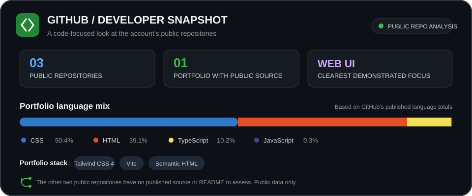

### Building AI-powered apps, SaaS products & automations

##  What I do

I build practical end-to-end products—from modern web interfaces and Python APIs to LLM integrations and automated workflows.

 

##  Tech stack

&nbsp;
&nbsp;
&nbsp;
&nbsp;
&nbsp;
&nbsp;
&nbsp;
&nbsp;
&nbsp;
&nbsp;
&nbsp;
&nbsp;
&nbsp;

 

&nbsp;
&nbsp;
&nbsp;
&nbsp;
&nbsp;
&nbsp;
&nbsp;
&nbsp;
&nbsp;
&nbsp;
&nbsp;
&nbsp;
&nbsp;
&nbsp;

 

##  GitHub at a glance

 

  

**Open to building useful products and collaborating on practical AI projects.**

